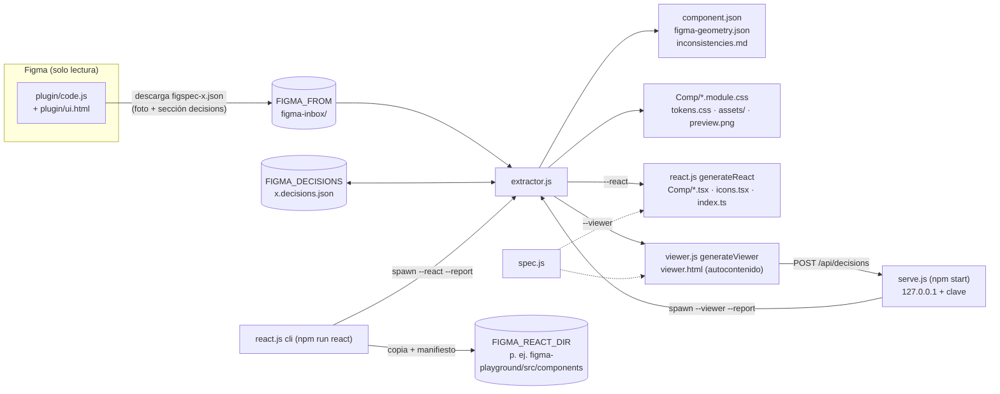

# Arquitectura de figspec

Cómo está armado figspec por dentro: qué módulo hace qué, por dónde pasan los datos desde Figma
hasta cada salida, qué no se puede romper y dónde tocar para cada tipo de cambio. Los formatos de
archivo (los contratos entre módulos) están en [formatos.md](formatos.md); el porqué de cada
decisión, en [decisiones/](decisiones/README.md).

Todo lo que dice este documento sale del código (se cita `archivo:función`). Si el código y este
documento no coinciden, manda el código: corrige el documento en el mismo cambio.

## La idea en una frase

Un plugin de solo lectura saca **una foto** del componente en Figma (`figspec-<componente>.json`);
el extractor la convierte en una **especificación** (`component.json`) y en **CSS Modules**; de esa
especificación salen, con la **misma interpretación** (`spec.js`), los componentes **React** y el
**visualizador** que los compara con Figma. Los nombres que decide una persona viven en un
**archivo de decisiones** del proyecto, nunca en Figma.

## Pipeline

Paso a paso:

1. **Figma → paquete.** `plugin/code.js:analyze` lista las capas con nombre vago y los grupos
   repetidos para que la ventana (`plugin/ui.html`) ofrezca nombrarlos. Al exportar,
   `plugin/code.js:exportRoot` arma el paquete: el nodo con `exportAsync({ format: "JSON_REST_V1" })`
   (mismo formato que la API REST), la geometría de los rotados (`addRotationGeometry`), los nombres
   de variables (`variables`), los SVG de los íconos (`iconCandidates` + `SVG_STRING`), las imágenes
   (`getImageByHash`), la vista previa PNG y, si se eligió algún nombre, la sección `decisions`
   (`namesFile`). `plugin/ui.html:save` pasa los binarios a base64 y lo descarga como
   `figspec-<componente>.json` (o "Copiar JSON" si la descarga falla).
2. **Paquete → especificación.** `extractor.js:main` elige el paquete (`env.js:bundleIn`,
   `newestCopy`), junta las fuentes de nombres (sección `decisions` del paquete, archivo del
   proyecto, `.names.json` y `.decisions.json` sueltos, `--decisions`) y las resuelve contra el
   árbol (`resolveDecisions`). Después construye el componente (`buildRoot` → `assemble` → `walk`),
   los subcomponentes (`buildSubs`), los repetidos (`findRepeated`, `extractRepeated` con
   `--extract-repeated`), `aria` (`ariaFor`) y las inconsistencias.
3. **Escritura.** `extractor.js:main` borra la salida anterior según su manifiesto (`cleanOutput`),
   escribe assets (`writeAssets`, con deduplicación de íconos por contenido), `component.json`,
   los CSS Modules (`moduleCss`), `tokens.css` (`tokensCss`), `preview.png`, y luego llama a los
   generadores opcionales **sobre la salida ya escrita**: `react.js:generateReact` y
   `viewer.js:generateViewer`. Al final escribe `figma-geometry.json`, `inconsistencies.md`, el
   manifiesto (`writeManifest`) y actualiza las decisiones del proyecto (`saveProjectDecisions`),
   solo si cambiaron.
4. **Revisión.** `viewer.html` embebe `spec.js` y `viewer-client.js` (`viewer.js:inlineModule`) más
   todos los datos; `viewer-client.js:renderTree` dibuja el componente en un Shadow DOM con los
   mismos `.module.css`. "Guardar nombres" descarga un `.decisions.json` (archivo suelto) o, si lo
   sirve `serve.js`, hace `POST /api/decisions` y el servidor vuelve a correr el extractor.
5. **Entrega.** `react.js:cli` (`npm run react`) corre el extractor con `--react`, copia la
   subcarpeta del componente y `tokens.css` a `FIGMA_REACT_DIR/<Componente>/` con su manifiesto y
   avisa los cambios de API (`apiSummary`, `apiChanges`).

## Mapa de módulos

| Módulo | Corre en | Responsabilidad (y solo esa) | Lo usan |
|---|---|---|---|
| `plugin/code.js` | Figma (sandbox del plugin) | Leer la selección y armar el paquete. Copia las reglas de nombres del extractor **solo para mostrar sugerencias** | `plugin/ui.html` |
| `plugin/ui.html` | Figma (iframe) | Ventana: nombres, estados, opciones, descarga | — |
| `env.js` | Node | `.env`, `~`, copias del navegador (`x (1).json`), carpetas por componente (`bundleIn`, `outDirFor`, `decisionsIn`), abrir archivos | extractor, viewer, serve, react |
| `extractor.js` | Node (CLI) | Figma → `component.json`, CSS, tokens, assets, geometría, inconsistencias; combinar y guardar decisiones; manifiesto de salida | serve, react (como proceso hijo) |
| `spec.js` | Node y navegador | **Interpretación** de `component.json`: condiciones por variante (`matches`, `pickCase`), estructura activa, valores por defecto, listas `.map`, nombres. Sin `fs` | react.js, viewer-client.js |
| `react.js` | Node | `generateReact`: `component.json` → `.tsx`. `cli`: entrega al proyecto con manifiesto y avisos de API | extractor (`--react`), `npm run react` |
| `viewer.js` | Node | Arma `viewer.html` autocontenido (datos, CSS, assets en `data:`, scripts en línea) | extractor (`--viewer`), `npm run viewer` |
| `viewer-client.js` | Navegador (y Node en pruebas) | Render, comparación con Figma, inspector, renombrar, guardar. Las funciones sin DOM se exportan para `node --test` | viewer.html |
| `viewer.css` | Navegador | Estilos del visualizador | viewer.html |
| `serve.js` | Node (`npm start`) | Servidor local: sirve `viewer.html` con una clave y recibe decisiones | — |
| `figma-playground/` | Vite (aparte) | Proyecto React real que recibe entregas; no es parte del paquete | `npm run playground` |

Dos detalles de forma que importan al cambiar cosas:

- **`extractor.js` no es una librería.** Lee `process.argv` y llama a `main()` al cargarse, y
  guarda el estado de la corrida en dos objetos de módulo (`opts`, `ctx`). Por eso `serve.js` y
  `react.js` lo ejecutan como **proceso hijo** (`spawnSync`) y reciben el resultado por un archivo
  `--report` (ver [formatos.md](formatos.md#reporte---report)). No lo importes con `require`.
- **Los generadores leen la salida escrita, no el estado en memoria.** `generateReact` y
  `generateViewer` leen `component.json` y los archivos del disco: así usan las rutas finales de
  los assets (después de deduplicar) y se pueden correr solos (`node viewer.js <salida>`).

## Quién es dueño de qué

| Responsabilidad | Dueño | Nota |
|---|---|---|
| Qué es un ícono, qué es vago, cómo se sugiere un nombre | `extractor.js` (sección "nombres sugeridos", `iconFor`, `isIconish`) | El plugin tiene una **copia** (`plugin/code.js`, sección "nombres"); la prueba de paridad en `test/plugin.test.js` las mantiene iguales |
| Cómo se traduce Figma a CSS | `extractor.js` (`placement`, `layoutCss`, `fillCss`, `strokeCss`, `textCss`, `fontCss`…) | React y el visualizador **no** generan CSS: usan los `.module.css` |
| Qué significa `component.json` (qué caso de variante gana, valores por defecto) | `spec.js` | Una sola implementación para React y visualizador |
| Nombres de clase y su estabilidad entre variantes | `extractor.js:classFor` (por ruta de capas) | Ver [ADR 0010](decisiones/0010-clases-por-ruta-de-capas.md) |
| Combinar nombres de distintas fuentes | `extractor.js:resolveDecisions` | El visualizador solo **produce** archivos (`viewer-client.js:decisionsDoc`) |
| Escribir el archivo de decisiones del proyecto | `extractor.js:saveProjectDecisions` | `serve.js` no lo escribe: le pasa un temporal al extractor con `--decisions` |
| Borrar salidas viejas | `extractor.js:cleanOutput` (salida), `react.js:cli` (destino) | Cada uno solo lo que listó en su manifiesto |

## Invariantes (no se rompen)

Cada una tiene su porqué en un ADR y, cuando se puede, una prueba que la defiende. Si un cambio
necesita romper una, primero se escribe un ADR nuevo que reemplace al anterior.

| # | Invariante | Cómo se defiende | ADR |
|---|---|---|---|
| 1 | **El plugin no escribe nada en Figma**: ni capas, ni nombres, ni `pluginData`, ni selección | `test/plugin.test.js`: el `figma` simulado falla ante cualquier escritura y una expresión regular revisa el código ("solo lectura: …") | [0002](decisiones/0002-plugin-de-solo-lectura.md) |
| 2 | **Cero dependencias en tiempo de ejecución**: solo módulos de Node (`fs`, `path`, `os`, `http`, `crypto`, `child_process`); pruebas con `node --test` | `package.json` sin `dependencies`. **No hay prueba automática** (ver riesgos) | [0006](decisiones/0006-cero-dependencias.md) |
| 3 | **Lo que muestra el visualizador es lo que se genera**: React y visualizador interpretan `component.json` con `spec.js` y usan los mismos `.module.css` | `test/spec.test.js` ("paridad: …"); la paridad HTML con React se comprobó con un arnés fuera del repo | [0007](decisiones/0007-spec-compartido-entre-visualizador-y-react.md) |
| 4 | **Heurísticas genéricas**: ninguna regla depende de un diseño concreto (nombres, textos, colores de un archivo real) | Revisión. Las pruebas usan diseños sintéticos (`test/naming.test.js`) | [0016](decisiones/0016-heuristicas-genericas.md) |
| 5 | **Los diseños privados no salen de la máquina**: sin red en plugin, extractor ni visualizador; carpetas de trabajo y paquetes fuera de git | `test/viewer.test.js` ("viewer.html no depende de archivos ni de la red"); `.gitignore` (`figma-*/*`, `figspec-*.json`) | [0009](decisiones/0009-los-disenos-no-salen-de-la-maquina.md) |
| 6 | **El servidor local solo escucha en 127.0.0.1**, exige la clave de la sesión (`X-Figspec-Token`) y un `Host` 127.0.0.1/localhost | `test/serve.test.js` prueba la clave (403 sin ella) y el cuerpo (400 si no es de decisiones); la comprobación de `Host` y el límite de 5 MB **no tienen prueba** | [0005](decisiones/0005-servidor-local-con-clave.md) |
| 7 | **El paquete `figspec-*.json` es la foto de Figma: nada lo modifica.** Los nombres van a otro archivo | Revisión (`serve.js:save` escribe `<paquete>.decisions.json`, nunca el paquete) | [0003](decisiones/0003-nombres-en-el-mismo-paquete.md) |
| 8 | **Cada herramienta borra solo lo que generó**, y nunca fuera de su carpeta | `extractor.js:cleanOutput` y `react.js:cli` comprueban `startsWith(root + sep)`; `test/viewer.test.js`, `test/react-cli.test.js` | [0012](decisiones/0012-manifiesto-de-salida.md), [0013](decisiones/0013-entrega-con-npm-run-react.md) |
| 9 | **Un lector nunca adivina una versión más nueva**: paquete, decisiones y `component.json` se rechazan con un mensaje claro | Paquete: `test/naming.test.js` ("un paquete de una versión más nueva falla…"); `component.json`: `test/viewer.test.js`. El rechazo de decisiones más nuevas (`readDecisions`) **no tiene prueba** | [0019](decisiones/0019-versionado-de-formatos.md) |
| 10 | **La raíz nunca se renombra sola**: su nombre es la API pública del componente | `test/naming.test.js` ("la raíz nunca se renombra sola") | [0016](decisiones/0016-heuristicas-genericas.md) |

## Dónde cambiar qué

**Soportar una propiedad nueva de Figma en el CSS** (p. ej. un efecto, un tipo de borde):

1. Busca la función de su familia en `extractor.js`: posición y tamaño en `placement`/`minMax`,
   auto layout en `layoutCss`/`paddingCss`, relleno en `fillCss`/`gradientCss`, borde en
   `strokeCss`, radio en `radiusCss`, sombras y desenfoques en `effectsCss`, opacidad y otros en
   `miscCss`, texto en `textCss`/`fontCss`.
2. Si el valor puede ir a un token, pásalo por `num`/`tokenize` (variables) o `styledColor`
   (estilos de color): así aparece en `tokens.css` con el valor de Figma como respaldo.
3. Si es una aproximación, deja una nota con `ctx.notes.add(...)`: llega a `meta.notes`.
4. Si `JSON_REST_V1` no trae el dato, el plugin lo puede agregar desde el nodo (como
   `plugin/code.js:addRotationGeometry`). Eso es un campo nuevo del paquete: lee las reglas de
   compatibilidad en [formatos.md](formatos.md#reglas-de-compatibilidad).
5. Prueba en `test/output.test.js`. React y el visualizador **no** se tocan: usan los
   `.module.css`. Las diferencias entre variantes las resuelve `diffStyles` sin cambios.

**Cambiar o agregar una regla de nombres** (qué es vago, cómo se sugiere): en `extractor.js`
(sección "nombres sugeridos": `isGeneric`, `vagueName`, `suggestName`, `usableText`…) **y** la copia
en `plugin/code.js` (sección "nombres"). La prueba "paridad" de `test/plugin.test.js` falla si
quedan distintas. Agrega un caso genérico en `test/naming.test.js`. Recuerda: los nombres de clase
son API pública de lo entregado (ver [ADR 0013](decisiones/0013-entrega-con-npm-run-react.md)).

**Un campo nuevo en `component.json` que React y el visualizador deben entender:**

1. Lo produce `extractor.js` (normalmente en `assemble` o `walk`).
2. Su significado va en `spec.js` (una función pura), no repetido en cada consumidor.
3. Lo consumen `react.js` (JSX) y `viewer-client.js:renderTree` (árbol virtual) llamando a esa
   función.
4. Prueba de paridad en `test/spec.test.js`; caso de render en `test/viewer.test.js`.
5. Si cambia la forma de algo existente, sube `COMPONENT_FORMAT` (ver
   [formatos.md](formatos.md#componentjson)).

**Una salida nueva** (otro framework, otro formato de tokens): sigue el patrón de `react.js`.

1. Un módulo con `generateX(outDir, part, write)` que lea `component.json` y los archivos ya
   escritos, e interprete la especificación con `spec.js`.
2. Una opción en `extractor.js` (`opts`, el parseo de `argv`, `envFlag("FIGMA_X")`, `printHelp`) y
   la llamada en `main()` junto a la de React: el `write` que recibe registra cada archivo en el
   manifiesto, así la próxima corrida lo reemplaza.
3. Si escribe en un proyecto ajeno, hazlo como `react.js:cli`: proceso hijo del extractor con
   `--report`, manifiesto propio en el destino, nunca pisar lo que no generó.
4. Cero dependencias (invariante 2): si el formato necesita una librería, va en un proyecto
   aparte como `figma-playground/`.

**Algo nuevo en el visualizador:** la lógica sin DOM en `viewer-client.js` como función exportada
(se prueba en `test/viewer.test.js`), la interfaz en `boot`, los estilos en `viewer.css`. Datos
nuevos desde Node: `viewer.js:viewerHtml` (objeto `data`). Nada de recursos externos (invariante 5).

**Un dato nuevo del paquete del plugin:** `plugin/code.js:exportRoot` lo agrega, `extractor.js:main`
lo lee. Si el extractor puede ignorarlo sin equivocarse, es compatible; si no, sube `figspec`
(ver [formatos.md](formatos.md#reglas-de-compatibilidad)). Pruébalo con el `figma` simulado de
`test/plugin.test.js`.

**Una variable de configuración:** `env.js` si es de rutas o carpetas; la opción en `opts` de
`extractor.js` (o del CLI que la use); documentarla en `.env.example`.

**Un tipo de decisión nuevo** (p. ej. grupos de repetidos): el archivo v2 ya reserva `groups: []`.
Lo lee `extractor.js:decisionEntries`/`resolveDecisions`, lo escribe `saveProjectDecisions` y lo
produce `viewer-client.js:decisionsDoc` (y `plugin/code.js:namesFile` si se elige en el plugin).
Ver [formatos.md](formatos.md#archivo-de-decisiones).

## Puntos de extensión

- **Generadores sobre la salida escrita** (`generateReact`, `generateViewer`): el lugar natural
  para nuevos destinos.
- **`spec.js`**: la única interpretación de `component.json`; extenderla beneficia a todos los
  consumidores a la vez.
- **`--report`**: contrato mínimo para que otra herramienta corra el extractor y sepa dónde quedó
  todo (lo usan `serve.js` y `react.js`).
- **Archivo de decisiones v2**: `groups` reservado; `origin` libre para nuevas fuentes.
- **`meta.notes`** e **`inconsistencies.md`**: el canal para avisar aproximaciones y posibles
  errores del diseño sin romper nada.

## Límites conocidos

Los del resultado (lo que el CSS aún no reproduce) están en `BACKLOG.md`, "Límites conocidos". Los
de arquitectura:

- **`extractor.js` es un archivo de ~3200 líneas con estado global** (`opts`, `ctx`). Funciona
  porque cada corrida es un proceso nuevo; impide usarlo como librería y hace que las pruebas
  pasen por procesos hijos.
- **Reglas de nombres duplicadas** entre extractor y plugin (el plugin corre en Figma y no puede
  importar archivos de Node). Las une una prueba de paridad, no el código.
- **Dos implementaciones parecidas de "qué caso gana"**: `extractor.js:resolvedText` (último caso
  gana, `===`) frente a `spec.js:pickCase` (primero gana, comparación como texto). Hoy no difieren
  porque `diffStyles` no genera casos superpuestos (anotado en `BACKLOG.md`).
- **La paridad visualizador ↔ React** se prueba a nivel de `spec.js`; la comparación del HTML
  completo (`renderToStaticMarkup`) se hizo con un arnés fuera del repo.
- **Solo se probó en Chrome** el visualizador; el plugin, solo en la app de escritorio de Figma.
- **Paquetes grandes**: imágenes en base64 dentro del JSON y de `viewer.html` (el login real pesa
  ~3 MB); sin medición de rendimiento con diseños grandes.
- **Rutas de capa** (`[[nombre, n], …]`) como respaldo del id: si una copia del componente reordena
  hermanos homónimos, la ruta apunta a otra capa.
